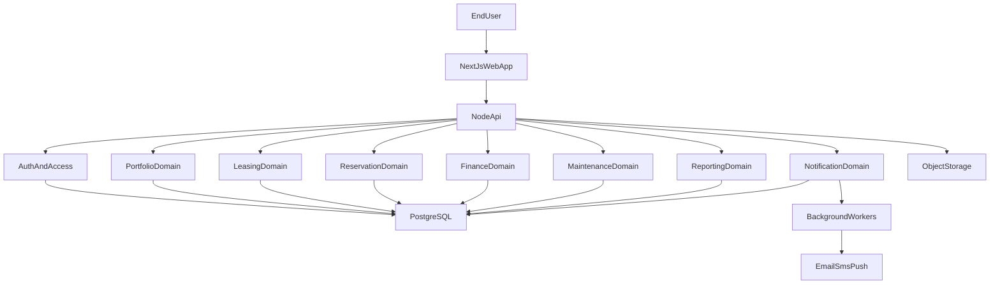
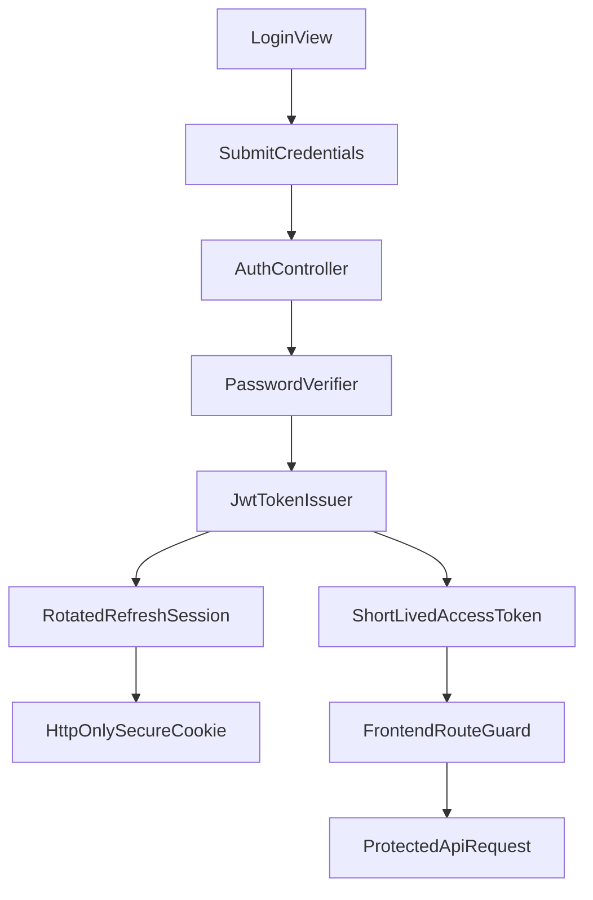
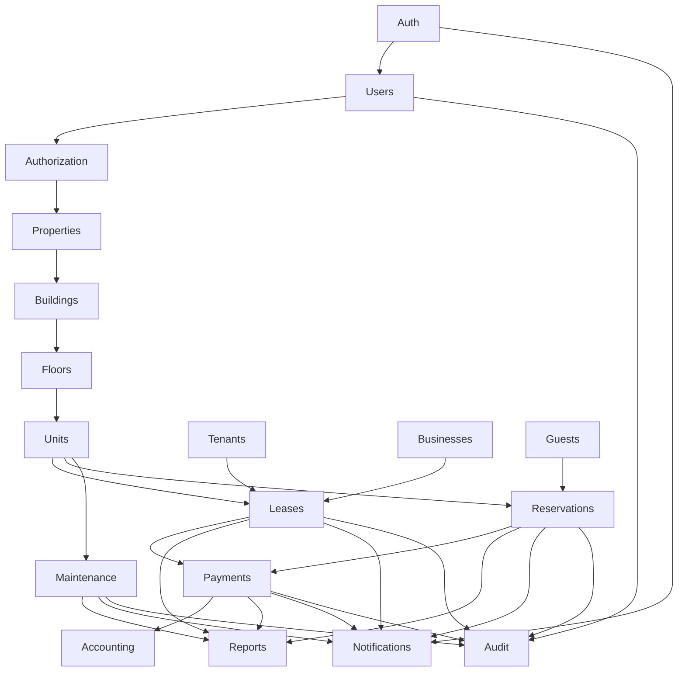

# Real Estate Management System Architecture

## 1. Architectural Goals

The architecture is designed to satisfy five priorities:

1. Scale across a large property portfolio.
2. Support multiple occupancy models in one platform.
3. Preserve clean module boundaries for long-term maintainability.
4. Enforce strong authorization and auditability.
5. Provide a premium enterprise UI with reusable foundations.

## 2. Backend Platform Decision

**Express + Prisma + PostgreSQL** is the system of record:

- PostgreSQL database managed via Prisma (`backend/prisma`)
- JWT auth (access + refresh tokens) with RBAC
- React + Vite frontend (`frontend/`) talks to the Express API

See [backend-api.md](./backend-api.md) for API reference.

## 3. Recommended Delivery Model

Use a modular monolith in a monorepo for the first major release.

Reasons:

- Faster delivery than a microservice system.
- Easier transactional consistency for finance, leasing, and reservations.
- Simpler developer workflow and lower infrastructure complexity.
- Domain modules can later be extracted if scale or team size requires it.

## 3. Solution Topology



## 4. Monorepo Structure

The project folder layout:

- [`frontend`](../frontend)
- [`backend`](../backend)
- [`docs`](.)

### 4.1 Frontend App

Path: [`frontend`](../frontend)

Recommended internal structure:

- `src/app`
  - App Router routes and layouts
- `src/features`
  - Feature modules such as `auth`, `properties`, `leases`, `reservations`, `payments`
- `src/components`
  - Reusable UI primitives and composite shared components
- `src/lib`
  - Session helpers, configuration, permission utilities
- `src/services`
  - API clients and data adapters
- `src/hooks`
  - Shared hooks for tables, filters, pagination, permissions
- `src/styles`
  - Tokens, globals, and theme definitions

### 4.2 Backend App

Path: [`backend`](../backend)

Recommended internal structure:

- `src/modules`
  - Domain-oriented modules
- `src/common`
  - Shared middleware, errors, guards, decorators, logger, response helpers
- `src/config`
  - Environment config and service registration
- `src/jobs`
  - Background jobs and scheduled tasks
- `prisma`
  - Schema, migrations, seed strategy
- `src/storage`
  - File upload and object storage adapters

## 5. Frontend Architecture

### 5.1 UI Principles

- Enterprise dashboard shell
- Responsive layouts from mobile through desktop
- Accessible components and keyboard support
- Design system tokens for light and dark mode
- Reusable data table and form frameworks

## 5.2 Route Groups

```text
/(auth)
  /login
  /forgot-password
  /reset-password
  /accept-invite

/(app)
  /dashboard
  /properties
  /buildings
  /floors
  /units
  /residential-leases
  /commercial-leases
  /reservations
  /tenants
  /businesses
  /guests
  /payments
  /accounting
  /maintenance
  /reports
  /notifications
  /staff
  /roles
  /settings
  /audit-logs
```

## 5.3 Shared UI Building Blocks

Each feature should reuse:

- `AppShell`
- `PageHeader`
- `FilterBar`
- `DataTable`
- `StatusBadge`
- `SummaryCard`
- `FormSection`
- `ConfirmDialog`
- `DrawerPanel`
- `EmptyState`
- `LoadingState`
- `ErrorState`
- `ExportMenu`
- `AuditTimeline`

## 5.4 Frontend State Strategy

- Server state: query library with caching and invalidation.
- Form state: schema-driven validation layer.
- Session state: auth provider and permission-aware route guards.
- UI state: local component state or scoped stores for complex flows.

## 6. Backend Architecture

## 6.1 Layering

Each module should follow:

1. Route / controller layer
2. Application service layer
3. Domain policy layer
4. Repository / data access layer
5. Persistence layer

This keeps business rules centralized and prevents UI or route logic from owning domain policy.

## 6.2 Domain Modules

Recommended module list under `src/modules`:

- `auth`
- `users`
- `authorization`
- `properties`
- `buildings`
- `floors`
- `units`
- `tenants`
- `businesses`
- `guests`
- `leases`
- `reservations`
- `payments`
- `accounting`
- `maintenance`
- `notifications`
- `reports`
- `audit`
- `files`

## 6.3 Cross-Cutting Backend Concerns

- Authentication middleware
- Permission guards
- Validation middleware
- Error normalization
- Structured request logging
- Audit event writer
- Rate limiting
- File upload sanitization
- Background job dispatch

## 7. Authentication Architecture

## 7.1 Flow



## 7.2 Decisions

- Use JWT access tokens for stateless API authorization.
- Use rotated refresh sessions to reduce risk from token theft.
- Store refresh token material in secure, HTTP-only cookies.
- Require password hashing with Argon2id or bcrypt with strong policy.
- Keep login audit events for success, failure, lockout, and session revocation.

## 8. Authorization Architecture

## 8.1 Model

Use RBAC plus granular permissions.

Example permission families:

- `users.read`, `users.write`
- `roles.read`, `roles.write`
- `properties.read`, `properties.write`
- `leases.read`, `leases.approve`
- `reservations.read`, `reservations.manage`
- `payments.read`, `payments.collect`, `payments.refund`
- `reports.read`, `reports.export`
- `maintenance.read`, `maintenance.assign`, `maintenance.close`
- `audit.read`

## 8.2 Scope

Permissions may apply at:

- global level
- property level
- building level

This allows the same permission framework to support executives, portfolio admins, local managers, and operational staff.

## 8.3 Enforcement

- UI: hide or disable inaccessible actions.
- API: deny access regardless of UI state.
- Audit: log denied or sensitive attempts where appropriate.

## 9. Module Dependency Diagram



## 10. Navigation Structure

Recommended main navigation:

1. Dashboard
2. Properties
3. Buildings
4. Floors
5. Units
6. Residential Leasing
7. Commercial Leasing
8. Reservations
9. Tenants
10. Businesses
11. Guests
12. Payments
13. Accounting
14. Maintenance
15. Reports
16. Notifications
17. Staff And Users
18. Roles And Permissions
19. Settings
20. Audit Logs

## 11. Reporting And Export Architecture

- Reports should be generated from permission-aware query services.
- Large exports should run as asynchronous jobs.
- PDF and Excel export requests should create export records with status tracking.
- Dashboards should start with indexed live queries and later evolve toward summary views and cached KPI snapshots.

## 12. Files And Documents

The system should store metadata in PostgreSQL and files in object storage.

File categories:

- lease documents
- reservation attachments
- tenant identity documents
- maintenance photos
- invoices and receipts
- exported reports

## 13. Observability And Operations

The architecture should include:

- structured server logs
- background job monitoring
- audit event trails
- database migration discipline
- centralized error formatting
- health-check endpoints

## 14. Architecture Rules For New Features

Every new feature must answer before coding:

1. Why it is needed.
2. Which bounded module owns it.
3. Which tables and indexes it requires.
4. Which API endpoints and actions it introduces.
5. Which screens and reusable UI primitives it needs.
6. Which permissions guard it.
7. Which workflow states and audit events it affects.
8. Which unit, integration, and end-to-end tests prove it.
