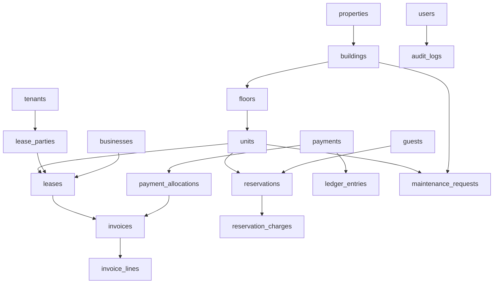

# Real Estate Management System Database Design

## 1. Design Principles

The database must support:

- normalized transactional storage
- strong referential integrity
- scalable reporting filters
- coexistence of residential, commercial, and short-term occupancy
- auditable financial workflows

Guiding rules:

1. Separate master data from transactional data.
2. Separate charges from payments.
3. Keep history instead of overwriting operational records.
4. Use soft delete only where business history matters.
5. Index every common filter path used by dashboards and reports.

## 2. Schema Domains

The schema is organized into these business domains:

- Identity and security
- Portfolio hierarchy
- Party management
- Leasing
- Reservations
- Billing and payments
- Accounting
- Maintenance
- Notifications
- Files and documents
- Audit and activity history

## 3. Entity Relationship Overview

## 4. Core Tables

## 4.1 Identity And Security

### `users`
- `id` UUID PK
- `email` VARCHAR UNIQUE NOT NULL
- `password_hash` TEXT NOT NULL
- `first_name` VARCHAR NOT NULL
- `last_name` VARCHAR NOT NULL
- `status` VARCHAR NOT NULL CHECK status IN (`invited`, `active`, `suspended`, `disabled`)
- `last_login_at` TIMESTAMP NULL
- `created_at` TIMESTAMP NOT NULL
- `updated_at` TIMESTAMP NOT NULL
- `deleted_at` TIMESTAMP NULL

Indexes:

- unique index on `email`
- index on `status`

### `roles`
- `id` UUID PK
- `name` VARCHAR UNIQUE NOT NULL
- `description` TEXT NULL
- `is_system_role` BOOLEAN NOT NULL DEFAULT false

### `permissions`
- `id` UUID PK
- `resource` VARCHAR NOT NULL
- `action` VARCHAR NOT NULL
- `code` VARCHAR UNIQUE NOT NULL

### `user_roles`
- `user_id` UUID FK -> `users.id` ON DELETE CASCADE
- `role_id` UUID FK -> `roles.id` ON DELETE CASCADE
- PK (`user_id`, `role_id`)

### `role_permissions`
- `role_id` UUID FK -> `roles.id` ON DELETE CASCADE
- `permission_id` UUID FK -> `permissions.id` ON DELETE CASCADE
- PK (`role_id`, `permission_id`)

### `user_scopes`
- `id` UUID PK
- `user_id` UUID FK -> `users.id` ON DELETE CASCADE
- `scope_type` VARCHAR NOT NULL CHECK scope_type IN (`global`, `property`, `building`)
- `scope_id` UUID NULL

Indexes:

- index on (`user_id`, `scope_type`)

### `refresh_sessions`
- `id` UUID PK
- `user_id` UUID FK -> `users.id` ON DELETE CASCADE
- `token_hash` TEXT NOT NULL
- `expires_at` TIMESTAMP NOT NULL
- `revoked_at` TIMESTAMP NULL
- `ip_address` VARCHAR NULL
- `user_agent` TEXT NULL

Indexes:

- index on `user_id`
- index on `expires_at`

## 4.2 Portfolio Hierarchy

### `properties`
- `id` UUID PK
- `code` VARCHAR UNIQUE NOT NULL
- `name` VARCHAR NOT NULL
- `property_type` VARCHAR NOT NULL CHECK property_type IN (`residential`, `commercial`, `mixed_use`, `hospitality`)
- `status` VARCHAR NOT NULL CHECK status IN (`active`, `inactive`, `archived`)
- `address_line_1` VARCHAR NOT NULL
- `address_line_2` VARCHAR NULL
- `city` VARCHAR NOT NULL
- `state_region` VARCHAR NULL
- `country` VARCHAR NOT NULL
- `postal_code` VARCHAR NULL
- `timezone` VARCHAR NOT NULL
- `created_at` TIMESTAMP NOT NULL
- `updated_at` TIMESTAMP NOT NULL
- `deleted_at` TIMESTAMP NULL

Indexes:

- unique index on `code`
- index on `status`
- index on `property_type`
- index on (`city`, `country`)

### `buildings`
- `id` UUID PK
- `property_id` UUID FK -> `properties.id` ON DELETE RESTRICT
- `code` VARCHAR NOT NULL
- `name` VARCHAR NOT NULL
- `status` VARCHAR NOT NULL CHECK status IN (`active`, `inactive`, `archived`)
- `number_of_floors` INTEGER NULL CHECK number_of_floors >= 0
- `created_at` TIMESTAMP NOT NULL
- `updated_at` TIMESTAMP NOT NULL
- UNIQUE (`property_id`, `code`)

Indexes:

- index on `property_id`
- index on `status`

### `floors`
- `id` UUID PK
- `building_id` UUID FK -> `buildings.id` ON DELETE RESTRICT
- `floor_number` INTEGER NOT NULL
- `name` VARCHAR NULL
- `created_at` TIMESTAMP NOT NULL
- `updated_at` TIMESTAMP NOT NULL
- UNIQUE (`building_id`, `floor_number`)

Indexes:

- index on `building_id`

### `units`
- `id` UUID PK
- `building_id` UUID FK -> `buildings.id` ON DELETE RESTRICT
- `floor_id` UUID FK -> `floors.id` ON DELETE RESTRICT
- `code` VARCHAR NOT NULL
- `name` VARCHAR NULL
- `unit_type` VARCHAR NOT NULL
- `occupancy_mode` VARCHAR NOT NULL CHECK occupancy_mode IN (`residential`, `commercial`, `short_term`, `hybrid`)
- `status` VARCHAR NOT NULL CHECK status IN (`available`, `occupied`, `reserved`, `maintenance`, `inactive`)
- `bedrooms` INTEGER NULL CHECK bedrooms >= 0
- `bathrooms` NUMERIC(4,2) NULL CHECK bathrooms >= 0
- `area_sqm` NUMERIC(12,2) NULL CHECK area_sqm >= 0
- `base_rate` NUMERIC(14,2) NULL CHECK base_rate >= 0
- `created_at` TIMESTAMP NOT NULL
- `updated_at` TIMESTAMP NOT NULL
- `deleted_at` TIMESTAMP NULL
- UNIQUE (`building_id`, `code`)

Indexes:

- index on `building_id`
- index on `floor_id`
- index on `occupancy_mode`
- index on `status`
- index on (`building_id`, `status`)

### `unit_amenities`
- `unit_id` UUID FK -> `units.id` ON DELETE CASCADE
- `amenity_code` VARCHAR NOT NULL
- PK (`unit_id`, `amenity_code`)

## 4.3 Party Management

### `tenants`
- `id` UUID PK
- `external_code` VARCHAR UNIQUE NULL
- `first_name` VARCHAR NOT NULL
- `last_name` VARCHAR NOT NULL
- `email` VARCHAR NULL
- `phone` VARCHAR NULL
- `government_id_type` VARCHAR NULL
- `government_id_number` VARCHAR NULL
- `date_of_birth` DATE NULL
- `status` VARCHAR NOT NULL CHECK status IN (`prospect`, `active`, `inactive`, `blacklisted`)
- `created_at` TIMESTAMP NOT NULL
- `updated_at` TIMESTAMP NOT NULL

Indexes:

- index on `email`
- index on `phone`
- index on `status`

### `businesses`
- `id` UUID PK
- `legal_name` VARCHAR NOT NULL
- `trade_name` VARCHAR NULL
- `registration_number` VARCHAR UNIQUE NULL
- `tax_number` VARCHAR UNIQUE NULL
- `email` VARCHAR NULL
- `phone` VARCHAR NULL
- `status` VARCHAR NOT NULL CHECK status IN (`prospect`, `active`, `inactive`)
- `created_at` TIMESTAMP NOT NULL
- `updated_at` TIMESTAMP NOT NULL

### `guests`
- `id` UUID PK
- `first_name` VARCHAR NOT NULL
- `last_name` VARCHAR NOT NULL
- `email` VARCHAR NULL
- `phone` VARCHAR NULL
- `nationality` VARCHAR NULL
- `date_of_birth` DATE NULL
- `status` VARCHAR NOT NULL CHECK status IN (`active`, `inactive`, `restricted`)
- `created_at` TIMESTAMP NOT NULL
- `updated_at` TIMESTAMP NOT NULL

### `vendors`
- `id` UUID PK
- `name` VARCHAR NOT NULL
- `service_type` VARCHAR NULL
- `email` VARCHAR NULL
- `phone` VARCHAR NULL
- `status` VARCHAR NOT NULL CHECK status IN (`active`, `inactive`)
- `created_at` TIMESTAMP NOT NULL
- `updated_at` TIMESTAMP NOT NULL

## 4.4 Leasing

### `leases`
- `id` UUID PK
- `lease_number` VARCHAR UNIQUE NOT NULL
- `unit_id` UUID FK -> `units.id` ON DELETE RESTRICT
- `lease_type` VARCHAR NOT NULL CHECK lease_type IN (`residential`, `commercial`)
- `business_id` UUID NULL FK -> `businesses.id` ON DELETE RESTRICT
- `status` VARCHAR NOT NULL CHECK status IN (`draft`, `pending_approval`, `active`, `expired`, `terminated`, `cancelled`)
- `start_date` DATE NOT NULL
- `end_date` DATE NOT NULL
- `notice_date` DATE NULL
- `currency_code` CHAR(3) NOT NULL
- `deposit_amount` NUMERIC(14,2) NOT NULL DEFAULT 0 CHECK deposit_amount >= 0
- `rent_amount` NUMERIC(14,2) NOT NULL DEFAULT 0 CHECK rent_amount >= 0
- `billing_frequency` VARCHAR NOT NULL CHECK billing_frequency IN (`monthly`, `quarterly`, `yearly`, `custom`)
- `created_by` UUID FK -> `users.id` ON DELETE RESTRICT
- `approved_by` UUID NULL FK -> `users.id` ON DELETE RESTRICT
- `approved_at` TIMESTAMP NULL
- `created_at` TIMESTAMP NOT NULL
- `updated_at` TIMESTAMP NOT NULL
- CHECK (`start_date` < `end_date`)

Indexes:

- unique index on `lease_number`
- index on `unit_id`
- index on `lease_type`
- index on `status`
- index on (`unit_id`, `status`)
- index on (`start_date`, `end_date`)

### `lease_parties`
- `lease_id` UUID FK -> `leases.id` ON DELETE CASCADE
- `tenant_id` UUID FK -> `tenants.id` ON DELETE RESTRICT
- `party_role` VARCHAR NOT NULL CHECK party_role IN (`primary`, `co_tenant`, `occupant`, `guarantor`)
- PK (`lease_id`, `tenant_id`)

### `lease_charges`
- `id` UUID PK
- `lease_id` UUID FK -> `leases.id` ON DELETE CASCADE
- `charge_type` VARCHAR NOT NULL
- `amount` NUMERIC(14,2) NOT NULL CHECK amount >= 0
- `frequency` VARCHAR NOT NULL CHECK frequency IN (`one_time`, `monthly`, `quarterly`, `yearly`, `custom`)
- `start_date` DATE NOT NULL
- `end_date` DATE NULL
- `is_active` BOOLEAN NOT NULL DEFAULT true

Indexes:

- index on `lease_id`
- index on `is_active`

## 4.5 Reservations

### `reservations`
- `id` UUID PK
- `reservation_number` VARCHAR UNIQUE NOT NULL
- `unit_id` UUID FK -> `units.id` ON DELETE RESTRICT
- `guest_id` UUID FK -> `guests.id` ON DELETE RESTRICT
- `status` VARCHAR NOT NULL CHECK status IN (`pending`, `confirmed`, `checked_in`, `checked_out`, `cancelled`, `no_show`)
- `check_in_date` DATE NOT NULL
- `check_out_date` DATE NOT NULL
- `adults_count` INTEGER NOT NULL DEFAULT 1 CHECK adults_count >= 1
- `children_count` INTEGER NOT NULL DEFAULT 0 CHECK children_count >= 0
- `currency_code` CHAR(3) NOT NULL
- `base_amount` NUMERIC(14,2) NOT NULL DEFAULT 0 CHECK base_amount >= 0
- `total_amount` NUMERIC(14,2) NOT NULL DEFAULT 0 CHECK total_amount >= 0
- `created_by` UUID FK -> `users.id` ON DELETE RESTRICT
- `created_at` TIMESTAMP NOT NULL
- `updated_at` TIMESTAMP NOT NULL
- CHECK (`check_in_date` < `check_out_date`)

Indexes:

- unique index on `reservation_number`
- index on `unit_id`
- index on `guest_id`
- index on `status`
- index on (`unit_id`, `check_in_date`, `check_out_date`)

### `reservation_charges`
- `id` UUID PK
- `reservation_id` UUID FK -> `reservations.id` ON DELETE CASCADE
- `charge_type` VARCHAR NOT NULL
- `description` VARCHAR NULL
- `amount` NUMERIC(14,2) NOT NULL CHECK amount >= 0
- `created_at` TIMESTAMP NOT NULL

Indexes:

- index on `reservation_id`

## 4.6 Billing And Payments

### `invoices`
- `id` UUID PK
- `invoice_number` VARCHAR UNIQUE NOT NULL
- `lease_id` UUID NULL FK -> `leases.id` ON DELETE RESTRICT
- `reservation_id` UUID NULL FK -> `reservations.id` ON DELETE RESTRICT
- `invoice_type` VARCHAR NOT NULL CHECK invoice_type IN (`lease`, `reservation`, `adjustment`, `deposit`)
- `status` VARCHAR NOT NULL CHECK status IN (`draft`, `issued`, `partially_paid`, `paid`, `void`)
- `issue_date` DATE NOT NULL
- `due_date` DATE NOT NULL
- `currency_code` CHAR(3) NOT NULL
- `subtotal_amount` NUMERIC(14,2) NOT NULL CHECK subtotal_amount >= 0
- `tax_amount` NUMERIC(14,2) NOT NULL DEFAULT 0 CHECK tax_amount >= 0
- `total_amount` NUMERIC(14,2) NOT NULL CHECK total_amount >= 0
- `balance_amount` NUMERIC(14,2) NOT NULL CHECK balance_amount >= 0
- `created_at` TIMESTAMP NOT NULL
- `updated_at` TIMESTAMP NOT NULL
- CHECK (`lease_id` IS NOT NULL OR `reservation_id` IS NOT NULL)

Indexes:

- unique index on `invoice_number`
- index on `lease_id`
- index on `reservation_id`
- index on `status`
- index on `due_date`

### `invoice_lines`
- `id` UUID PK
- `invoice_id` UUID FK -> `invoices.id` ON DELETE CASCADE
- `line_type` VARCHAR NOT NULL
- `reference_id` UUID NULL
- `description` VARCHAR NOT NULL
- `quantity` NUMERIC(14,2) NOT NULL DEFAULT 1 CHECK quantity > 0
- `unit_price` NUMERIC(14,2) NOT NULL CHECK unit_price >= 0
- `line_total` NUMERIC(14,2) NOT NULL CHECK line_total >= 0

Indexes:

- index on `invoice_id`

### `payments`
- `id` UUID PK
- `payment_number` VARCHAR UNIQUE NOT NULL
- `payer_type` VARCHAR NOT NULL CHECK payer_type IN (`tenant`, `business`, `guest`)
- `payer_id` UUID NOT NULL
- `payment_method` VARCHAR NOT NULL CHECK payment_method IN (`cash`, `card`, `bank_transfer`, `mobile_money`, `wallet`, `other`)
- `status` VARCHAR NOT NULL CHECK status IN (`pending`, `completed`, `failed`, `reversed`, `refunded`)
- `currency_code` CHAR(3) NOT NULL
- `amount` NUMERIC(14,2) NOT NULL CHECK amount >= 0
- `paid_at` TIMESTAMP NULL
- `received_by` UUID NULL FK -> `users.id` ON DELETE RESTRICT
- `reference_number` VARCHAR NULL
- `created_at` TIMESTAMP NOT NULL
- `updated_at` TIMESTAMP NOT NULL

Indexes:

- unique index on `payment_number`
- index on (`payer_type`, `payer_id`)
- index on `status`
- index on `paid_at`

### `payment_allocations`
- `id` UUID PK
- `payment_id` UUID FK -> `payments.id` ON DELETE CASCADE
- `invoice_id` UUID FK -> `invoices.id` ON DELETE RESTRICT
- `allocated_amount` NUMERIC(14,2) NOT NULL CHECK allocated_amount > 0
- `created_at` TIMESTAMP NOT NULL
- UNIQUE (`payment_id`, `invoice_id`)

Indexes:

- index on `payment_id`
- index on `invoice_id`

## 4.7 Accounting

### `chart_of_accounts`
- `id` UUID PK
- `account_code` VARCHAR UNIQUE NOT NULL
- `account_name` VARCHAR NOT NULL
- `account_type` VARCHAR NOT NULL CHECK account_type IN (`asset`, `liability`, `equity`, `income`, `expense`)
- `parent_account_id` UUID NULL FK -> `chart_of_accounts.id` ON DELETE RESTRICT
- `is_active` BOOLEAN NOT NULL DEFAULT true

### `ledger_entries`
- `id` UUID PK
- `entry_number` VARCHAR UNIQUE NOT NULL
- `entry_date` DATE NOT NULL
- `source_type` VARCHAR NOT NULL CHECK source_type IN (`invoice`, `payment`, `refund`, `adjustment`, `expense`)
- `source_id` UUID NOT NULL
- `description` VARCHAR NOT NULL
- `created_by` UUID FK -> `users.id` ON DELETE RESTRICT
- `created_at` TIMESTAMP NOT NULL

Indexes:

- unique index on `entry_number`
- index on `entry_date`
- index on (`source_type`, `source_id`)

### `ledger_lines`
- `id` UUID PK
- `ledger_entry_id` UUID FK -> `ledger_entries.id` ON DELETE CASCADE
- `account_id` UUID FK -> `chart_of_accounts.id` ON DELETE RESTRICT
- `debit_amount` NUMERIC(14,2) NOT NULL DEFAULT 0 CHECK debit_amount >= 0
- `credit_amount` NUMERIC(14,2) NOT NULL DEFAULT 0 CHECK credit_amount >= 0
- CHECK (`debit_amount = 0 OR credit_amount = 0`)
- CHECK (`debit_amount > 0 OR credit_amount > 0`)

Indexes:

- index on `ledger_entry_id`
- index on `account_id`

## 4.8 Maintenance

### `maintenance_requests`
- `id` UUID PK
- `request_number` VARCHAR UNIQUE NOT NULL
- `property_id` UUID NULL FK -> `properties.id` ON DELETE RESTRICT
- `building_id` UUID NULL FK -> `buildings.id` ON DELETE RESTRICT
- `floor_id` UUID NULL FK -> `floors.id` ON DELETE RESTRICT
- `unit_id` UUID NULL FK -> `units.id` ON DELETE RESTRICT
- `reported_by_user_id` UUID NULL FK -> `users.id` ON DELETE SET NULL
- `reported_by_tenant_id` UUID NULL FK -> `tenants.id` ON DELETE SET NULL
- `title` VARCHAR NOT NULL
- `description` TEXT NULL
- `priority` VARCHAR NOT NULL CHECK priority IN (`low`, `medium`, `high`, `urgent`)
- `status` VARCHAR NOT NULL CHECK status IN (`open`, `assigned`, `in_progress`, `on_hold`, `resolved`, `closed`, `cancelled`)
- `assigned_to_user_id` UUID NULL FK -> `users.id` ON DELETE SET NULL
- `vendor_id` UUID NULL FK -> `vendors.id` ON DELETE SET NULL
- `opened_at` TIMESTAMP NOT NULL
- `resolved_at` TIMESTAMP NULL
- `closed_at` TIMESTAMP NULL
- `estimated_cost` NUMERIC(14,2) NULL CHECK estimated_cost >= 0
- `actual_cost` NUMERIC(14,2) NULL CHECK actual_cost >= 0
- `created_at` TIMESTAMP NOT NULL
- `updated_at` TIMESTAMP NOT NULL

Indexes:

- unique index on `request_number`
- index on `property_id`
- index on `building_id`
- index on `unit_id`
- index on `status`
- index on `priority`
- index on `assigned_to_user_id`

### `maintenance_notes`
- `id` UUID PK
- `maintenance_request_id` UUID FK -> `maintenance_requests.id` ON DELETE CASCADE
- `author_user_id` UUID FK -> `users.id` ON DELETE RESTRICT
- `note_body` TEXT NOT NULL
- `created_at` TIMESTAMP NOT NULL

## 4.9 Notifications

### `notification_templates`
- `id` UUID PK
- `code` VARCHAR UNIQUE NOT NULL
- `channel` VARCHAR NOT NULL CHECK channel IN (`email`, `sms`, `push`, `in_app`)
- `subject_template` VARCHAR NULL
- `body_template` TEXT NOT NULL
- `is_active` BOOLEAN NOT NULL DEFAULT true

### `notifications`
- `id` UUID PK
- `template_id` UUID NULL FK -> `notification_templates.id` ON DELETE SET NULL
- `recipient_type` VARCHAR NOT NULL CHECK recipient_type IN (`user`, `tenant`, `business`, `guest`)
- `recipient_id` UUID NOT NULL
- `channel` VARCHAR NOT NULL CHECK channel IN (`email`, `sms`, `push`, `in_app`)
- `status` VARCHAR NOT NULL CHECK status IN (`queued`, `sent`, `delivered`, `failed`, `read`)
- `subject` VARCHAR NULL
- `body` TEXT NOT NULL
- `scheduled_for` TIMESTAMP NULL
- `sent_at` TIMESTAMP NULL
- `created_at` TIMESTAMP NOT NULL

Indexes:

- index on (`recipient_type`, `recipient_id`)
- index on `status`
- index on `scheduled_for`

## 4.10 Files And Documents

### `files`
- `id` UUID PK
- `storage_key` VARCHAR UNIQUE NOT NULL
- `file_name` VARCHAR NOT NULL
- `mime_type` VARCHAR NOT NULL
- `file_size_bytes` BIGINT NOT NULL CHECK file_size_bytes >= 0
- `category` VARCHAR NOT NULL
- `uploaded_by` UUID FK -> `users.id` ON DELETE RESTRICT
- `created_at` TIMESTAMP NOT NULL

### `file_links`
- `id` UUID PK
- `file_id` UUID FK -> `files.id` ON DELETE CASCADE
- `entity_type` VARCHAR NOT NULL
- `entity_id` UUID NOT NULL
- UNIQUE (`file_id`, `entity_type`, `entity_id`)

Indexes:

- index on (`entity_type`, `entity_id`)

## 4.11 Audit And Activity

### `audit_logs`
- `id` UUID PK
- `actor_user_id` UUID NULL FK -> `users.id` ON DELETE SET NULL
- `entity_type` VARCHAR NOT NULL
- `entity_id` UUID NOT NULL
- `action` VARCHAR NOT NULL
- `old_values` JSONB NULL
- `new_values` JSONB NULL
- `ip_address` VARCHAR NULL
- `user_agent` TEXT NULL
- `created_at` TIMESTAMP NOT NULL

Indexes:

- index on `actor_user_id`
- index on (`entity_type`, `entity_id`)
- index on `created_at`

### `activity_logs`
- `id` UUID PK
- `entity_type` VARCHAR NOT NULL
- `entity_id` UUID NOT NULL
- `message` VARCHAR NOT NULL
- `created_by` UUID NULL FK -> `users.id` ON DELETE SET NULL
- `created_at` TIMESTAMP NOT NULL

Indexes:

- index on (`entity_type`, `entity_id`)
- index on `created_at`

## 5. Cascade And Delete Strategy

Use cascades only for dependent records that are not meaningful on their own.

Use `ON DELETE CASCADE` for:

- join tables such as `user_roles`, `role_permissions`
- child detail tables such as `invoice_lines`, `payment_allocations`, `maintenance_notes`, `unit_amenities`, `file_links`
- child party relations such as `lease_parties`, `lease_charges`

Use `ON DELETE RESTRICT` for business-critical parent-child relationships where deletion would destroy history:

- properties -> buildings
- buildings -> floors
- floors -> units
- units -> leases
- units -> reservations
- leases -> invoices
- reservations -> invoices
- accounting references

Use `ON DELETE SET NULL` where preserving event history matters more than preserving the direct actor link:

- audit actor references
- some maintenance reporter / assignee references
- notification template references

## 6. Normalization Notes

- Parties are separated by business meaning: `tenants`, `businesses`, and `guests`.
- Lease participants are modeled through `lease_parties` to support co-tenancy and guarantors.
- Financial amounts are normalized across `invoices`, `invoice_lines`, `payments`, and `payment_allocations`.
- Accounting is separated from operational billing so ledger design can evolve independently.
- File metadata is separated from storage associations for reuse across modules.

## 7. Performance Strategy

### 7.1 High-Value Indexes

Operational query hotspots should be indexed on:

- `property_id`
- `building_id`
- `floor_id`
- `unit_id`
- `status`
- `start_date`, `end_date`
- `check_in_date`, `check_out_date`
- `due_date`
- `paid_at`
- `created_at`

### 7.2 Reporting Optimization

As data grows:

- introduce materialized views for occupancy and executive KPIs
- introduce summary tables for monthly revenue and collection trends
- keep exports asynchronous
- avoid heavy cross-domain joins in interactive screens when a denormalized read model can serve the use case

## 8. Data Integrity Constraints To Enforce In Application Logic

Some business constraints are better enforced with both database checks and application services:

1. Prevent overlapping active leases for the same unit.
2. Prevent overlapping confirmed occupancy ranges for the same short-term unit.
3. Ensure invoice balance cannot become negative after allocations.
4. Ensure journal entries remain balanced before posting.
5. Restrict certain status transitions to approved workflows.

## 9. Suggested Future Enhancements

- Multi-organization tenancy boundary
- Currency conversion support
- Tax configuration tables
- Dynamic pricing rules for short-term reservations
- Preventive maintenance scheduling tables
- Report snapshot tables for historical dashboard reproducibility
